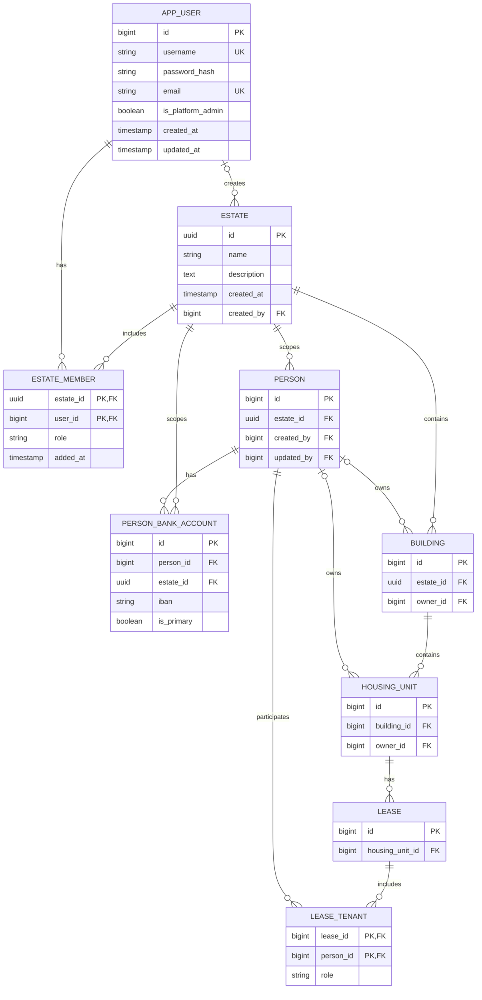

# User, Estate, Person, and Property Data Model

This page shows the current account and estate relationships, together with person, property, ownership, lease-membership, and person-bank-account relationships.

## Account, estate, person, and property entities

`APP_USER`, `ESTATE`, `ESTATE_MEMBER`, `PERSON`, `PERSON_BANK_ACCOUNT`, `BUILDING`, `HOUSING_UNIT`, and `LEASE_TENANT` are persisted as `app_user`, `estate`, `estate_member`, `person`, `person_bank_account`, `building`, `housing_unit`, and `lease_tenant`. An estate membership has the composite key `(estate_id, user_id)`. Lease membership has the composite key `(lease_id, person_id)`. Deleting a user account cascades to its membership rows; deleting a person cascades to person bank accounts, while lease membership references restrict person deletion.

The account has a global platform-administrator flag, while estate-specific roles are stored on membership rows. A platform administrator may also have estate memberships. The model does not directly link a user account to a `Person` record, although domain records may store user audit references; assessing whether such a link would be useful is tracked in the [backlog](../../../backlog/backlog.md).

The [person data dictionary](../people/person-data-dictionary.md) documents the `person` and `person_bank_account` fields and constraints. The [user account data dictionary](../user-accounts-and-authentication/user-account-data-dictionary.md) documents account fields; the [estate data dictionary](../estates-and-access/estate-data-dictionary.md) documents estate and membership fields. See [Person Management](../people/person-management.md) for person operations, [Building Management](../buildings-and-housing-units/building-management.md) for building operations, [User Account Management](../user-accounts-and-authentication/user-management.md) for account operations, and [Estate Management](../estates-and-access/estate-management.md) for estate operations.
