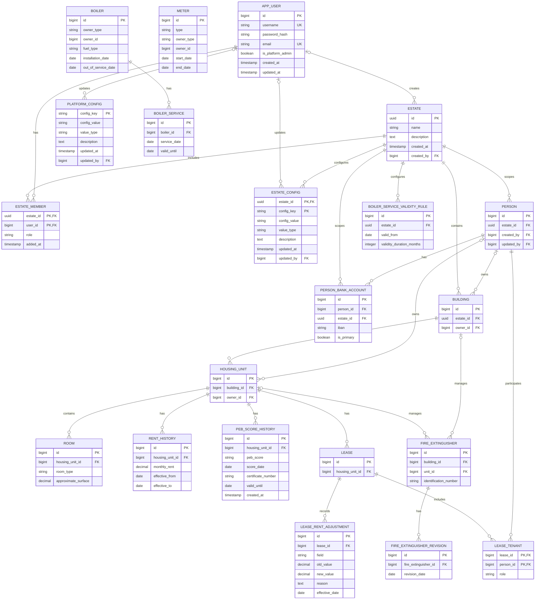

# User, Estate, Configuration, Person, Room, Rent, PEB, Equipment, and Property Data Model

This page shows the current account, estate, and configuration relationships, together with person, property, room, rent-history, PEB-history, ownership, lease-membership, lease rent-adjustment, and person-bank-account relationships.

## Account, estate, person, room, and property entities

`APP_USER`, `ESTATE`, `ESTATE_MEMBER`, `PLATFORM_CONFIG`, `ESTATE_CONFIG`, `PERSON`, `PERSON_BANK_ACCOUNT`, `BUILDING`, `HOUSING_UNIT`, `ROOM`, `RENT_HISTORY`, `PEB_SCORE_HISTORY`, `METER`, `BOILER`, `BOILER_SERVICE`, `BOILER_SERVICE_VALIDITY_RULE`, `FIRE_EXTINGUISHER`, `FIRE_EXTINGUISHER_REVISION`, `LEASE`, `LEASE_TENANT`, and `LEASE_RENT_ADJUSTMENT` are persisted as `app_user`, `estate`, `estate_member`, `platform_config`, `estate_config`, `person`, `person_bank_account`, `building`, `housing_unit`, `room`, `rent_history`, `peb_score_history`, `meter`, `boiler`, `boiler_service`, `boiler_service_validity_rule`, `fire_extinguisher`, `fire_extinguisher_revision`, `lease`, `lease_tenant`, and `lease_rent_adjustment`. `platform_config` is keyed by `config_key`; `estate_config` has the composite key `(estate_id, config_key)`. An estate membership has the composite key `(estate_id, user_id)`. Lease membership has the composite key `(lease_id, person_id)`. Deleting a user account cascades to its membership rows; deleting a person cascades to person bank accounts, while lease membership references restrict person deletion. A room, rent-history record, and PEB-history record each reference one housing unit; the database cascades their deletion when the housing unit is deleted, although the housing-unit service currently blocks deletion if rooms remain. Lease rent adjustments reference one lease and cascade when that lease is deleted.

The domain model does not associate a regulated reference rent directly with a lease; external regulation may govern lease terms without creating that relationship ([BR-LEASE-001](../../business/leases/rules/leases.md)). The current application does not persist regulated reference-rent data.

Platform-wide configuration has no estate relationship; estate key/value configuration belongs to an estate. See [Cross-Cutting Configuration Management](./configuration-management.md). Boiler-service validity rules are a separate dated history documented in [Boiler Management](../equipment/boiler-management.md).

Meters store an `owner_type` and `owner_id` pair to refer to either a building or a housing unit. This polymorphic association is not represented by a foreign key or an entity relationship in the diagram. There is no separate meter-event table: replacement preserves the previous meter as a closed meter record, while readings and maintenance events are not stored. See the [meter data dictionary](../equipment/meter-data-dictionary.md) and [meter management reference](../equipment/meter-management.md).

Boilers use the same polymorphic `owner_type` and `owner_id` pattern, without an owner foreign key. A boiler has many service records; an estate has its own dated boiler-service validity rules. Fire extinguishers reference either a building or a housing unit, and a database check requires exactly one owner context. Their revision records cascade when the extinguisher is deleted; deleting a unit-owned extinguisher is restricted by the housing-unit foreign key. See the [boiler data dictionary](../equipment/boiler-data-dictionary.md), [fire-extinguisher data dictionary](../equipment/fire-extinguisher-data-dictionary.md), and their [management references](../equipment/README.md).

The account has a global platform-administrator flag, while estate-specific roles are stored on membership rows. A platform administrator may also have estate memberships. The model does not directly link a user account to a `Person` record, although domain records may store user audit references; assessing whether such a link would be useful is tracked in the [backlog](../../../backlog/backlog.md).

The [person data dictionary](../people/person-data-dictionary.md) documents the `person` and `person_bank_account` fields and constraints. The [user account data dictionary](../user-accounts-and-authentication/user-account-data-dictionary.md) documents account fields; the [estate data dictionary](../estates-and-access/estate-data-dictionary.md) documents estate and membership fields; the [housing-unit data dictionary](../buildings-and-housing-units/housing-unit-data-dictionary.md) documents housing-unit, room, PEB-history, and rent-history fields; and the [equipment data dictionaries](../equipment/README.md) document meter, boiler, and fire-extinguisher fields. See [Person Management](../people/person-management.md) for person operations, [Building Management](../buildings-and-housing-units/building-management.md) for building operations, [Housing Unit Management](../buildings-and-housing-units/housing-unit-management.md) for housing-unit operations, [Room Management](../buildings-and-housing-units/room-management.md) for room operations, [PEB Score Management](../buildings-and-housing-units/peb-score-management.md) for PEB rating and certificate behavior, [Housing-Unit Rent History Management](../buildings-and-housing-units/rent-history-management.md) for housing-unit rent history, [Lease Technical References](../leases/README.md) for lease rent and charge adjustments, [Boiler Management](../equipment/boiler-management.md), [Fire Extinguisher Management](../equipment/fire-extinguisher-management.md), [Meter Management](../equipment/meter-management.md), [User Account Management](../user-accounts-and-authentication/user-management.md), and [Estate Management](../estates-and-access/estate-management.md).
