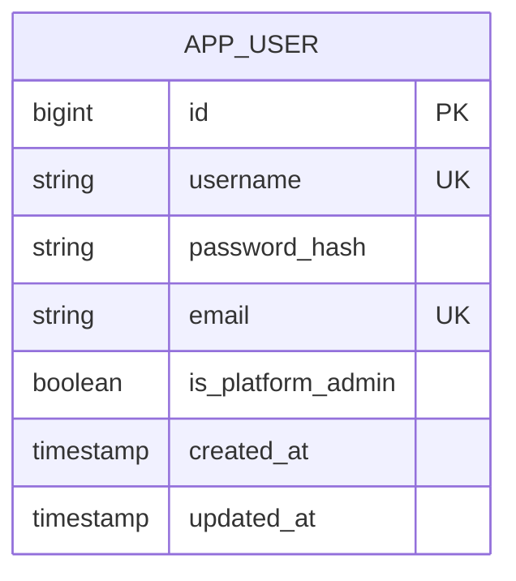

# User Data Model

This page carries forward only the user-account entity from the legacy [data model](../../docs/analysis/data-model.md). Other entities and relationships in that document are excluded until verified against the current implementation.

## Account entity

`APP_USER` is persisted as `app_user`. The model has a global platform-administrator flag; it does not store the legacy `role` field. Estate-specific access is modeled separately from this account entity. There is no dedicated identity relationship between an account and a `Person` record, although domain records may store user audit references; whether an account-to-person identity link is needed is an [open question](../../backlog/open_questions.md#user-accounts).

See the [user data dictionary](./data-dictionary.md) for field constraints and the technical [user-management](./user-management.md) reference for account operations.
