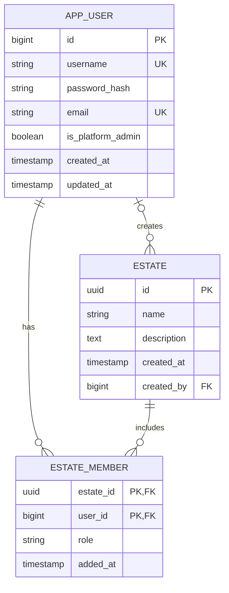

# User and Estate Data Model

This page carries forward the user-account, estate, and estate-membership entities from the legacy [data model](../../docs/analysis/data-model.md), verified against the current implementation. Other entities and relationships in that document remain excluded until verified.

## Account, estate, and membership entities

`APP_USER`, `ESTATE`, and `ESTATE_MEMBER` are persisted as `app_user`, `estate`, and `estate_member`. An estate membership has the composite key `(estate_id, user_id)`. Deleting a user account cascades to its membership rows; deleting an estate cascades to membership rows, but not all estate-scoped data references use cascade deletion.

The account has a global platform-administrator flag, while estate-specific roles are stored on membership rows. The model does not directly link a user account to a `Person` record, although domain records may store user audit references; whether an account-to-person identity link is needed is an [open question](../../backlog/open_questions.md#user-accounts).

See the [account and estate data dictionary](./data-dictionary.md) for persisted field constraints, [User Account Management](./user-management.md) for account operations, and [Estate Management](./estate-management.md) for estate operations.
